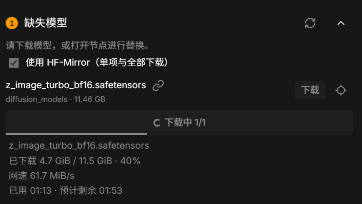

# ComfyUI Model Mirror

在 ComfyUI 缺失模型列表上方提供「使用 HF-Mirror（单项与全部下载）」开关，默认开启，选择保存在当前浏览器。开启时通过原有的「下载」和「全部下载」按钮下载镜像文件，保留工作流链接中的仓库、revision 和文件路径，并将文件保存到 ComfyUI 的模型目录。关闭时使用 ComfyUI 自带的下载流程，原站下载进度由浏览器显示。

把本仓库放入 ComfyUI 的 `custom_nodes`，重启 ComfyUI，再刷新浏览器。Docker 部署可把插件仓库挂载到 `/opt/ComfyUI/custom_nodes/comfyui-model-mirror`。单项下载成功或批量下载结束后，插件会调用面板的原生刷新操作，重新检查已下载的模型。

开启镜像时，「全部下载」按列表逐个处理，显示当前序号。某个文件失败时，可重试、查魔搭、粘贴直链、跳过该文件或结束本批。使用魔搭前请核对仓库、版本、精度和量化格式。结束后会显示下载、跳过和未完成的数量。

镜像下载期间，面板中的下载按钮和开关会禁用，当前按钮显示旋转指示和进度。按钮下方按行显示文件名、下载量、近几秒的网速，以及已用与预计剩余时间，每秒更新。下载源未返回文件大小或当前无传输时，预计剩余时间显示为 `—`。

面板接入基于 ComfyUI 前端 1.58.5 的组件属性，升级前端后需复测。后端只接受支持的模型站点，下载时使用临时文件，已有模型不会被覆盖。工作流提供 SHA-256 时会先校验。仅适用于本机使用的 ComfyUI。
